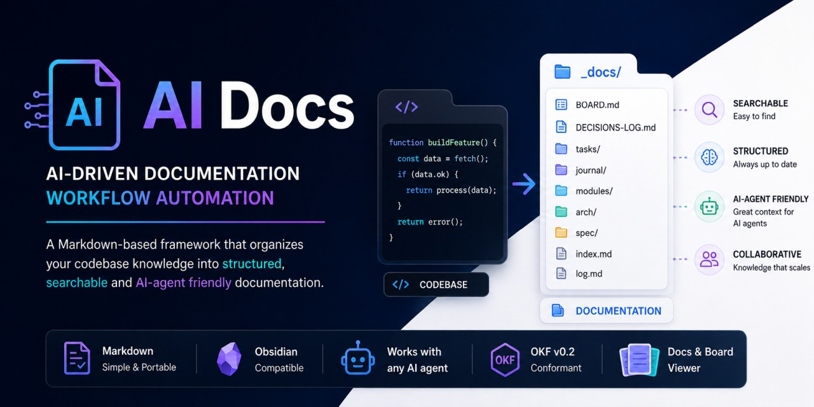
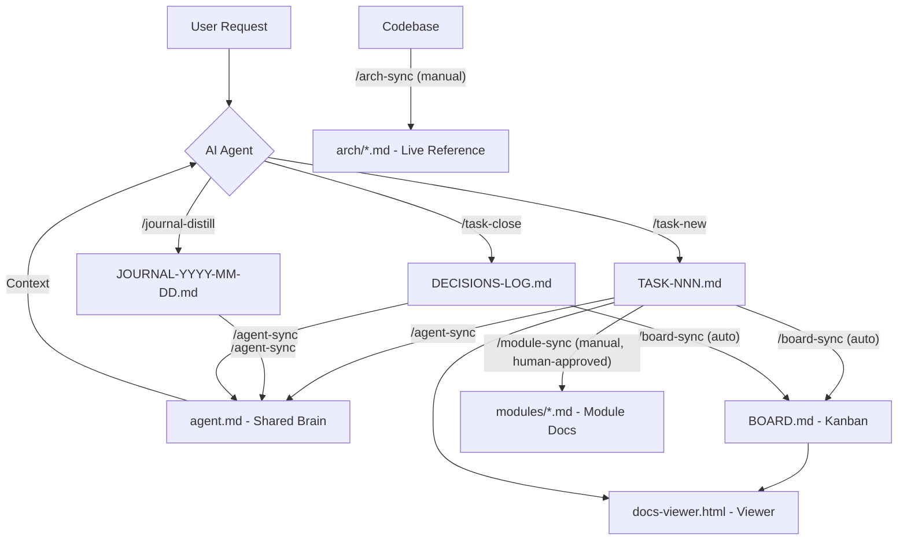

# AI Docs 🚀

> **AI-driven documentation workflow automation.**

`AI Docs` is a Markdown-based framework that keeps your development process structured and searchable, with a special focus on collaborative work with AI agents (e.g., Antigravity, Claude Code, OpenCode).


[](https://github.com/GoogleCloudPlatform/knowledge-catalog/blob/main/okf/SPEC.md)

Since v0.2 of this template, `_docs/` is also an [Open Knowledge Format](https://github.com/GoogleCloudPlatform/knowledge-catalog/blob/main/okf/SPEC.md)-conformant knowledge bundle: `type`-tagged concepts, `index.md`/`log.md` reserved files, and plain markdown cross-links instead of Obsidian wikilinks — so any generic OKF consumer (not just Obsidian) can read it without translation.

---

## ✨ Key Features

- 🤖 **Automated Workflows**: TASK, JOURNAL, and ADR-based documentation management via `/` commands.
- 🧠 **Shared Brain (`agent.md`)**: A stable, agent-facing digest (what the project is, tech stack, where things live, conventions) plus a map into `_docs/` — kept free of status content so it never drifts from `PROJECT-OVERVIEW.md`.
- 📊 **Project Overview (`PROJECT-OVERVIEW.md`)**: The single generated source of current project status — active tasks, decisions, recent journals — kept in sync with `_docs/index.md` via `/project-sync`.
- 📋 **Plaintext Kanban (`BOARD.md`)**: Auto-generated task board with per-task subtask progress — no external tool needed.
- 🏗️ **Live Architecture Reference (`arch/`)**: Stack, directory map, entry points, DB schema, config/env, and integrations, regenerated from the actual codebase via `/arch-sync`.
- 🧩 **Module Docs (`modules/`)**: Durable, per-module reference files (responsibility, dependencies, invariants) kept current via a manual, human-approved delta sync.
- 🖥️ **Docs & Board Viewer (`tool/`)**: A portable, server-less HTML/JS viewer that loads your `_docs/` folder and renders kanban, reader and search views — no Obsidian required, bilingual (EN/HU) UI.
- 💎 **Modern Aesthetics**: Structured Markdown format readable everywhere.
- 📂 **Obsidian Compatibility**: The `_docs/` folder works immediately as an Obsidian vault (with Dataview support).
- 🛠️ **Customizable**: Easily expandable using your agent's Workflows and Skills.

---

## 🛠️ How it Works

The system documents every step of the development cycle so knowledge is not lost between chat sessions.



---

## 📂 Folder Structure

```
project-root/
├── agent.md                  ← Shared Brain (generated by /agent-sync)
├── README.md                 ← your project's own README (the template ships a placeholder)
├── CLAUDE.md / AGENTS.md / … ← your agent's native file, bridged by /install
├── LICENSE                   ← the framework's MIT license
├── .agents/
│   ├── workflows/            ← /command workflow definitions
│   ├── skills/               ← Reusable agent skills
│   |   └── documentation/
│   |       └── SKILL.md      ← Documentation skills
│   └── rules/                ← Rules for the agent
│       └── style-guide.md    ← Style guide and conventions
├── tool/
│   └── docs-viewer.html      ← Standalone Docs & Board Viewer (open in a browser)
└── _docs/
    ├── README.md             ← Detailed documentation guide
    ├── index.md              ← [OKF] bundle root index (reserved filename)
    ├── log.md                ← [OKF] chronological history (reserved filename)
    ├── BOARD.md              ← [GENERATED] plaintext kanban view of all tasks (via /board-sync)
    ├── DECISIONS-LOG.md      ← ADR log (generated/updated by /task-close)
    ├── PROJECT-OVERVIEW.md   ← Project map (generated by /project-sync)
    ├── _archive/             ← Archived, non-indexed document backups
    ├── tasks/                ← TASK-NNN_name.md files (+ index.md)
    ├── journal/              ← JOURNAL-YYYY-MM-DD-topic.md files (+ index.md)
    ├── modules/              ← [MANUAL] durable per-module reference docs (via /module-sync) (+ index.md)
    ├── arch/                 ← [GENERATED] stack, directory map, entry points, DB schema, config/env, integrations (via /arch-sync)
    ├── spec/                 ← Business specs, user stories
    └── _templates/           ← Templates for all document types (TASK, JOURNAL, MODULE, BOARD, PROJECT-OVERVIEW, DECISIONS-LOG, plus the arch/* templates)
```

---

## 🚀 Quick Start

### 1. Requirements

An **agentic AI development environment** is required to run the workflows — such as:
- [Antigravity](https://antigravity.dev)
- [Claude Code](https://claude.ai/code)
- [OpenCode](https://opencode.ai)

Once bridged with `/install` (step 3), these tools read `.agents/workflows/` and execute `/` commands directly in the chat.

### 2. Get the clean template

> ⚠️ **Don't clone `main`.** This repository documents itself with its own framework, so `main`'s `agent.md`, `_docs/PROJECT-OVERVIEW.md`, tasks, ADRs, log and board describe **AI Docs**, not your project. The **`release`** branch holds the same framework with an empty knowledge bundle, kept in sync with `main` on every framework change.

**New project:**

```bash
git clone --depth 1 --branch release https://github.com/dynamicart/ai-docs.git my-project
cd my-project
rm -rf .git && git init    # drop AI Docs' history and origin remote; PowerShell: Remove-Item -Recurse -Force .git
```

Or download [`release.zip`](https://github.com/dynamicart/ai-docs/archive/refs/heads/release.zip) and extract it. The zip contains no git history.

**Existing project:** extract [`release.zip`](https://github.com/dynamicart/ai-docs/archive/refs/heads/release.zip) somewhere else and copy **only** these into your repo root:

- `.agents/` — framework rules, skills, workflows (and the framework's MIT license, `.agents/LICENSE`)
- `_docs/` — the empty knowledge bundle
- `tool/` — the standalone viewer (optional)

Do **not** copy the template's placeholder `README.md` over your own. If your repo already has a `_docs/` or `.agents/` folder, merge by hand instead of overwriting. Your `README.md`, `LICENSE`, `.gitignore` and `CHANGELOG.md` stay untouched: the `release` branch ships no `.gitignore` or `CHANGELOG.md`, and keeps its license under `.agents/`.

### 3. Bootstrap the agent bridge (once per agent)

Agentic tools generally don't auto-load `.agents/` or `agent.md`: each auto-loads only its own native file (e.g. `CLAUDE.md`, `AGENTS.md`, `GEMINI.md`, `.cursor/rules/`). The first time you open this project with a **new** agent, run:

```
/install
```
or type
```
run @.agents/workflows/install.md /install command
```

The agent detects its own native auto-loaded file and writes a short bridge section into it, pointing at `agent.md` and `.agents/` (on Claude Code it also creates native `/` command wrappers). This runs once per agent, not once per session. Re-running it is safe and refreshes the command wrappers after a framework update.

### 4. Describe your project, then initialize the Shared Brain

A fresh project has neither `_docs/PROJECT-OVERVIEW.md` nor `agent.md`. Create them in this order:

```
/project-sync
/agent-sync
```

The first `/project-sync` run asks about your project (name, purpose, goals, stack, owner) and writes `_docs/PROJECT-OVERVIEW.md`. `/agent-sync` then builds `agent.md` in the project root from it. From this point on, every agent session starts with fresh, up-to-date context.

### 5. Bootstrap the architecture reference (recommended for existing codebases)

```
/arch-sync
```

On first run this scans the actual codebase and fills in `_docs/arch/*.md` (stack, directory map, entry points, DB schema, config/env, integrations). Re-run any time the codebase structure changes meaningfully.

### 6. Start your first task

```
/task-new title="Project initialization"
```

The task automatically appears on `_docs/BOARD.md`.

### 7. Browse the bundle with the viewer

No Obsidian? The repository ships a standalone, server-less viewer. Open it in any modern browser and drop the `_docs/` folder onto the window (or click **Load folder**):

```bash
open tool/docs-viewer.html
```

You get three views — kanban board, markdown reader and global search — and a language switch (EN/HU) in the top-right corner. A single `BOARD.md` file can be dropped in as well; the viewer auto-switches the board source accordingly.

---

## ⚡ Workflow Commands

All workflows live in `.agents/workflows/`. Supported commands:

| Command | Description | Trigger |
|---|---|---|
| `/install` | Bootstraps a new AI agent's native bridge into the framework — writes a reference block into that agent's own auto-loaded file (`CLAUDE.md`, `AGENTS.md`, `GEMINI.md`, etc.) pointing at `.agents/` and `agent.md`. Re-running safely updates the bridge in-place. | manual, once per agent |
| `/upgrade` | Upgrades the framework in an existing project: refreshes the native agent bridge in-place, syncs native command/skill wrappers, ensures required directory structures exist, and runs `/agent-sync`. | manual |
| `/agent-sync` | Update the `agent.md` file. | manual |
| `/task-new [title]` | Creates a new `TASK-NNN_name.md` file from the template (auto-links matching briefs and plans). | manual |
| `/task-new from-brief [brief-file]` | Creates a new TASK based on a human-authored brief in `_docs/tasks/briefs/`. | manual |
| `/task-new from-journal` | Creates a new TASK based on a closed JOURNAL entry. | manual |
| `/plan-new [TASK-NNN \| title]` | Generates or updates a detailed technical implementation plan in `_docs/tasks/plans/`. | manual |
| `/task-close [TASK-NNN]` | Closes the task, updates status, records decisions into `DECISIONS-LOG.md`. | manual |
| `/task-close with-journal [TASK-NNN]` | Closes the task AND distills a final journal entry. | manual |
| `/journal-distill` | Saves the essence of the current chat session into a structured JOURNAL file. | manual |
| `/project-sync` | Regenerates `_docs/PROJECT-OVERVIEW.md` with the current project state. | manual |
| `/arch-sync [target]` | Regenerates the `arch/*.md` live-reference files from the codebase. | manual |
| `/module-sync <module-name> [TASK-NNN]` | Proposes a human-approved delta update to a single `modules/*.md` file — never auto-runs. | manual only |
| `/board-sync` | Fully rebuilds `_docs/BOARD.md`, the plaintext kanban view of all tasks. Pure read+render, no approval gate. | **auto** (end of `/task-new`, `/task-close`) + manual |

### Typical daily workflow

```
# 1. (Optional) Human writes a brief in _docs/tasks/briefs/TASK-001_brief.md

# 2. Plan technical implementation with the agent
/plan-new TASK-001
# → Generates _docs/tasks/plans/TASK-001_plan.md

# 3. Begin new work (or /task-new from-brief _docs/tasks/briefs/TASK-001_brief.md)
/task-new title="Add user authentication"
# → BOARD.md updates automatically with milestones from the plan

# 4. Save important decisions from chat
/journal-distill

# 5. Development happens... check off items in the TASK's "Approach / Plan" checklist as you go

# 6. Finish the task
/task-close with-journal TASK-001
# → BOARD.md updates automatically

# 7. Update Shared Brain and architecture references if structural changes occurred
/agent-sync
/arch-sync

# Update the project map for next time if necessary
/project-sync

# 8. Update module docs if a specific module's invariants were touched
/module-sync billing TASK-001
```

---

## 📄 License

This project is available under the **MIT License**. See the [LICENSE](LICENSE) file for details.

---
